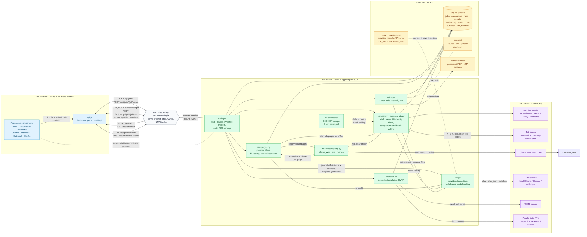
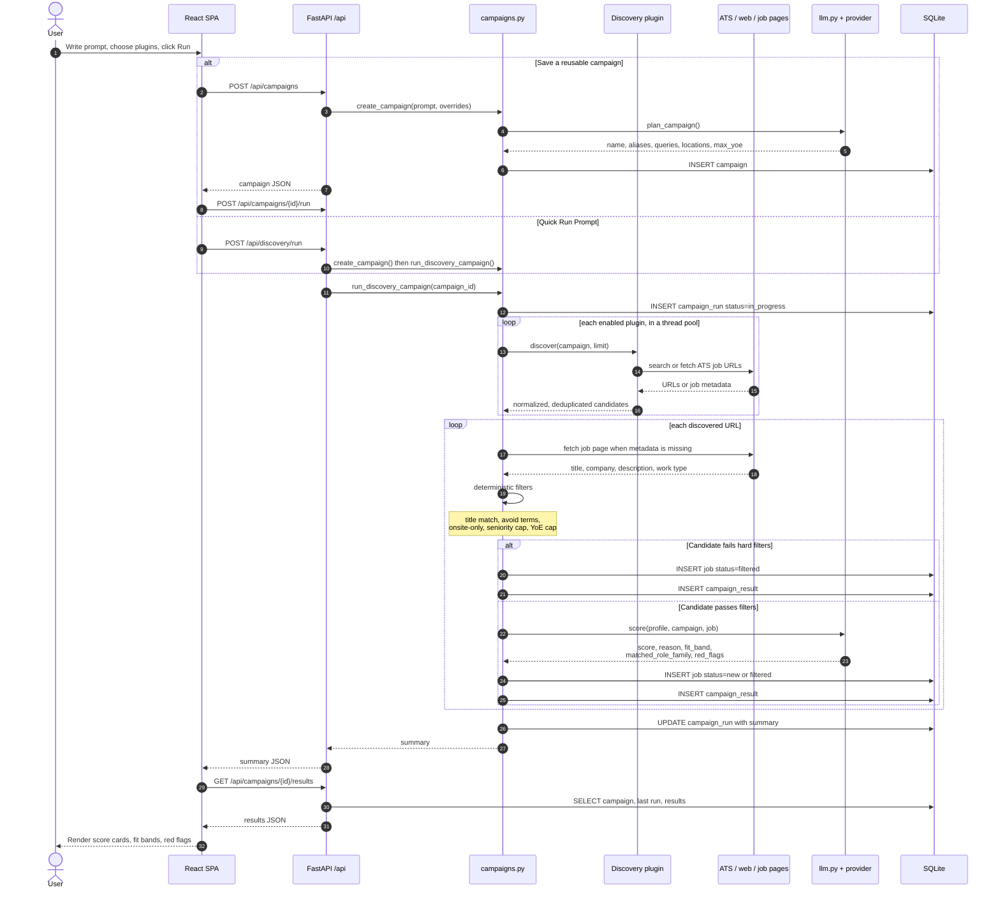
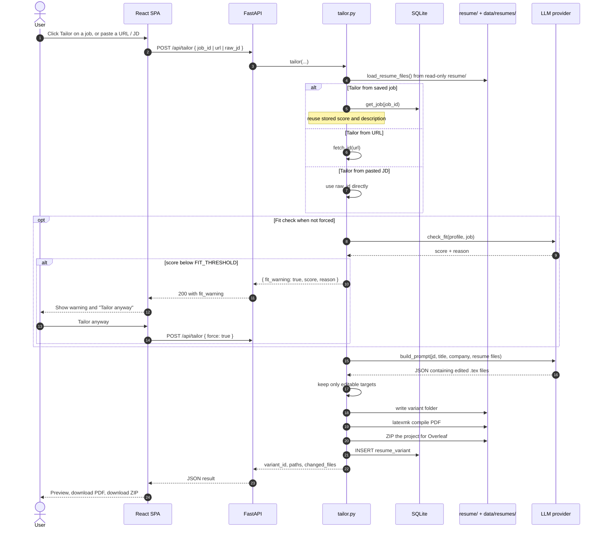
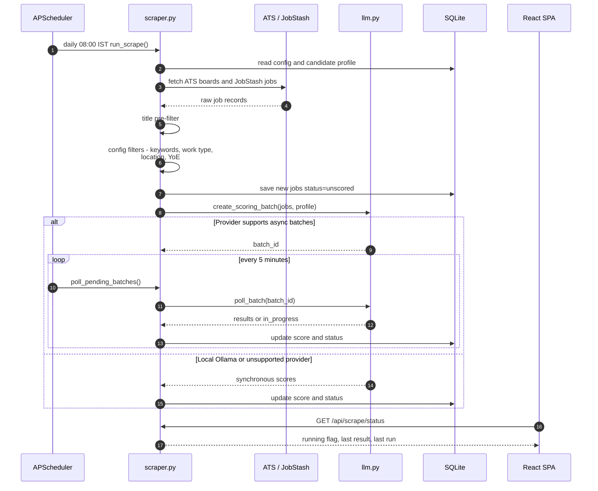

# OpenClaw Architecture

How the React frontend, FastAPI backend, SQLite store, LLM providers, and external job sources fit together.

> Render these diagrams on GitHub, in VS Code with the Markdown Preview Mermaid extension, or at <https://mermaid.live>.

---

## 1. System architecture and frontend/backend interaction

Solid arrows are request/response paths. Dotted arrows are static serving or read-only mounts.

### Reading the diagram

- The browser never talks to SQLite, ATS boards, or the LLM directly. Everything goes through `api.js` and the `/api` HTTP boundary.
- `main.py` is the only entry point. It validates requests with Pydantic models, calls a service module, and returns JSON.
- `campaigns.py` is the orchestration layer for discovery. It fans work out to discovery plugins, materializes job pages, applies deterministic filters, and asks `llm.py` to score fit.
- `llm.py` is the single choke point for model calls. Scoring, planning, tailoring, interview answers, and outreach templates all route through it, with per-task model selection.
- SQLite is the system of record. Resume PDFs and ZIPs live on disk under `data/resumes/`.
- In production the React build is served by FastAPI from `src/frontend/dist`. In development Vite runs on `:5173` and CORS allows that origin.

---

## 2. Campaign discovery: request/response sequence

**Key API calls**

| User action | Frontend call | Backend handler | Service |
|---|---|---|---|
| Load queue | `GET /api/jobs?status=new` | `get_jobs` | `db.list_jobs` |
| Load all results | `GET /api/jobs/all` | `get_all_jobs` | `db.list_all_jobs` |
| Open a job | `GET /api/jobs/{id}` | `get_job` | `db.get_job` |
| Apply / skip | `POST /api/jobs/{id}/status` | `update_job_status` | `db.set_status` |
| Create campaign | `POST /api/campaigns` | `post_campaign` | `campaigns.create_campaign` |
| Run campaign | `POST /api/campaigns/{id}/run` | `run_campaign` | `campaigns.run_discovery_campaign` |
| Quick run | `POST /api/discovery/run` | `run_prompt_discovery` | `campaigns.create_campaign` + run |
| Inspect run | `GET /api/campaigns/{id}/results` | `get_campaign_results` | `db.get_campaign_results` |
| Archive / restore | `POST /api/campaigns/{id}/archive` or `/restore` | matching route | `db.set_campaign_enabled` |
| Manual scrape | `POST /api/scrape` | `start_scrape` | `scraper.run_scrape` in background |
| Scrape status | `GET /api/scrape/status` | `scrape_status` | in-memory state |
| Batch poll | `POST /api/batches/poll` | `poll_batches` | `scraper.poll_pending_batches` |

---

## 3. Resume tailoring: request/response sequence

**Generated artifacts**

| Artifact | Path | Served by |
|---|---|---|
| Edited LaTeX project | `data/resumes/<company>_<timestamp>/` | filesystem |
| Compiled PDF | `<variant>/resume.pdf` | `GET /api/variants/{id}/pdf` |
| ZIP for Overleaf | `<variant>.zip` | `GET /api/variants/{id}/zip` |
| Variant metadata | SQLite `resume_variants` | `GET /api/variants` |

---

## 4. Background scraping and batch scoring

---

## 5. Layer responsibilities

| Layer | Files | Responsibility |
|---|---|---|
| UI | `src/frontend/src/pages/*`, `components/*` | Tabs, forms, cards, modals, local view state |
| API client | `src/frontend/src/api.js` | One `fetch` wrapper; all backend calls go through it |
| HTTP API | `src/backend/main.py` | Routing, validation, error mapping, SPA serving, scheduler startup |
| Campaign engine | `src/backend/campaigns.py` | Prompt-to-campaign planning, plugin fan-out, filters, fit scoring, run summaries |
| Discovery | `src/backend/discovery/*` | Plugin interface and concrete plugins |
| Scraping | `src/backend/scraper.py`, `sources_ats.py` | Fetching, parsing, dedupe, title/config filters, batch polling |
| LLM gateway | `src/backend/llm.py` | Provider abstraction, JSON mode, task-specific models, batching |
| Tailoring | `src/backend/tailor.py` | Constrained LaTeX edits, PDF compile, ZIP packaging, variants |
| Outreach | `src/backend/outreach.py` | Contact discovery, templates, bulk SMTP send |
| Persistence | `src/backend/db.py` | Schema, migrations, all SQLite reads/writes |

---

## 6. Notes and caveats

- The plugin registry currently registers three plugins: `ollama_web`, `ats`, and `manual`. Older docs also mention `hn` and `web3`; the corresponding scrapers still exist in `scraper.py` but are not registered as campaign plugins.
- `run_scrape()` currently executes ATS and JobStash sources; the DuckDuckGo site-search branch is commented out.
- `api.js` still exports `startBatchScore`, `stopBatchScore`, and `getBatchScoreStatus`, but `main.py` has no `/api/batch-score/*` routes. The working batch endpoints are `GET /api/batches` and `POST /api/batches/poll`.
- Campaign creation and scoring are synchronous HTTP requests from the browser's point of view. Long runs can take a while; the UI disables the action while waiting.
- The source resume tree is mounted read-only. Only the variant output directory is writable.
